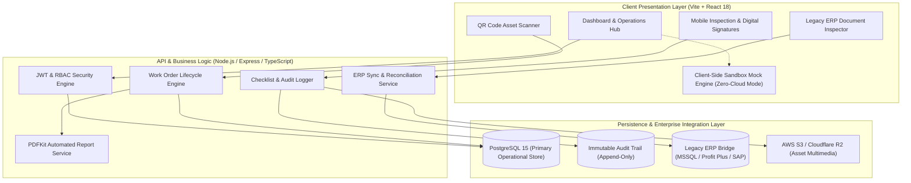

# OptiAsset CMMS — Enterprise Asset & Industrial Maintenance Architecture

[](https://react.dev/)
[](https://www.typescriptlang.org/)
[](https://www.postgresql.org/)
[](https://nodejs.org/)
[](https://www.docker.com/)
[](https://opensource.org/licenses/MIT)

> **Enterprise Computerized Maintenance Management System (CMMS) & Industrial Reliability Platform.**  
> Designed from first principles by a **Lean Six Sigma Black Belt & Operations Lead** to drive OEE (Overall Equipment Effectiveness), reduce unplanned downtime, enforce regulatory compliance, and bridge modern web engineering with legacy enterprise ERP systems.

---

## 🏗️ System Architecture



---

## 🌟 Core Functional Modules

### 1. Unified Asset Registry & Fleet Management
* **Multi-Category Tracking**: Heavy machinery, electric forklifts, stamp presses, and plant infrastructure.
* **Instant QR Access**: Generate and scan QR badges affixed to physical equipment for immediate mobile history retrieval.
* **Dynamic Specifications (JSONB)**: Flexible operational schemas accommodating hours run, engine mileage, calibration cycles, and maintenance manuals.

### 2. Multi-Phase Work Orders & Cost Engine
* **Full Maintenance Lifecycle**: Transitions across *Abierta* (Open) ➔ *En Proceso* (In-Progress) ➔ *Completada* (Closed) ➔ *Cancelada*.
* **Real-Time Labor & Spares Costing**: Automatically computes labor costs against certified mechanic hourly rates combined with frozen historical spare parts pricing.
* **Automated PDF Work Reports**: Generates formal, audit-ready engineering work orders via `PDFKit` with digital signatures and itemized receipts.

### 3. Mobile-First Inspection Checklists
* **Operator Pre-Operational Audits**: Responsive, field-ready checklists for vehicle inspections (fluid levels, tire pressure, brakes, hydraulic leaks).
* **Cryptographic Signatures & Verification**: Operator and supervisor sign-offs recorded with immutable timestamps to satisfy ISO 9001 quality audits.

### 4. Legacy ERP Synchronization Engine (MSSQL Bridge)
* **Heterogeneous Dual-Database Design**: Simultaneously queries PostgreSQL for high-speed web operations while communicating over TDS with on-premise MSSQL ERP instances.
* **Bi-directional Reconciliation**: Matches local maintenance requests with ERP delivery notes (*Notas de Entrega*), purchase orders, and stock movements.
* **Interactive Sandbox Inspector**: Built-in document viewer allowing operators to cross-reference legacy ERP records without direct database console access.

### 5. Warehouse Clearout & 5S Campaign Module
* **Lean Asset Redirection**: Dedicated categorization for equipment decommissioning: *Para Venta* (Sale), *Para Reciclaje* (Scrap), *Para Mantenimiento* (Refurbishment), or *Para Eliminación* (Disposal).
* Eliminates spatial clutter and frees working capital in accordance with 5S lean methodologies.

---

## 🔒 Cybersecurity & Immutable Audit Architecture

* **Role-Based Access Control (RBAC)**: Fine-grained permissions matrix distinguishing *Administrador*, *Mecánico*, *Chofer/Operador*, and *Operador Logístico*.
* **Append-Only Audit Logs**: Every critical state mutation (`CREAR_ACTIVO`, `MODIFICAR_ORDEN`, `SUBIR_CHECKLIST`) writes an immutable snapshot storing user ID, previous values, new values, and UTC timestamps.
* **Zero-Leak Protocol**: Complete decoupling of sensitive production database dumps (`.bak`), proprietary client configs, and environment credentials from public repositories.

---

## 🚀 Quickstart & Local Setup

### Prerequisites
* **Node.js** >= 18.x
* **Docker** & **Docker Compose** (for database containers)

### 1. Clone & Setup Environment
```bash
git clone https://github.com/desousaejai/optiasset-cmms.git
cd optiasset-cmms
cp .env.example .env
```

### 2. Launch Local Database Containers
```bash
docker compose up -d postgres
```

### 3. Install & Start Application
```bash
# Install frontend dependencies
npm --prefix frontend install

# Install backend dependencies
npm --prefix backend install

# Start both services concurrently
npm run dev:backend &
npm run dev:frontend
```
Access the application at `http://localhost:3000`.

---

## ⚡ Standalone Live Demo Mode (Vercel)

For recruiters and public reviewers, OptiAsset CMMS features an **Integrated In-Memory Mock Engine** that automatically activates on Vercel deployments.

* **No server or database installation required.**
* Click **"⚡ Demo Admin"** on the login screen to explore full administrative privileges:
  * Browse real industrial machinery (Toyota 2.5T Forklifts, Schuler Press HP-200, Atlas Copco Compressors).
  * Create, edit, and transition Work Orders.
  * Inspect pre-operational checklists.
  * Test the legacy ERP document simulation viewer.

---

## 👤 Author & Engineering Credits

* **Lead Architect**: **Eduardo De Sousa**
* **Role**: Operations & Automation Lead | Lean Six Sigma Black Belt | Full-Stack Systems Builder
* **Portfolio**: [https://eduardodesousa.vercel.app](https://eduardodesousa.vercel.app)
* **LinkedIn**: [linkedin.com/in/eduardo-desousa](https://www.linkedin.com/in/eduardo-desousa/)

---

## 📄 License
This project is licensed under the MIT License — see the [LICENSE](LICENSE) file for details.
